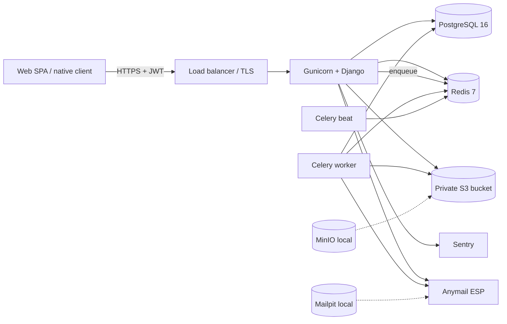
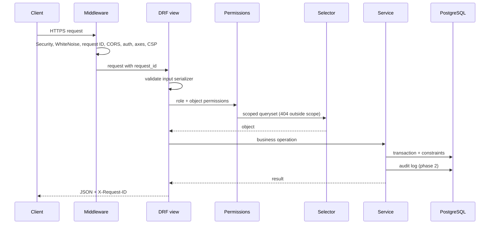
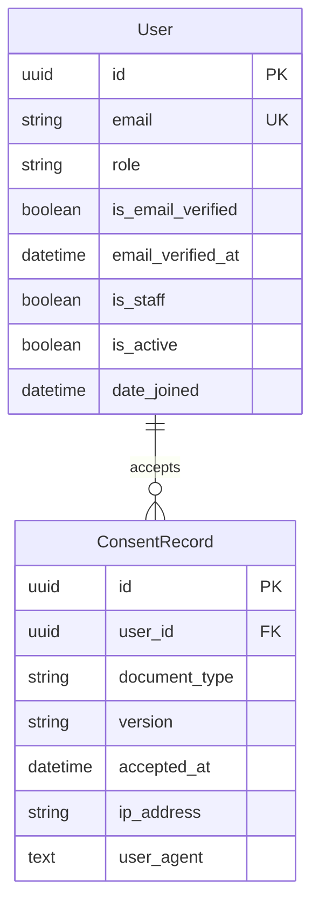

# Architecture

## 1. Context

Adelgaceya is a physician-supervised telehealth product in Peru. Patients
complete a medical assessment, upload labs, are reviewed by a physician, and
receive a prescription and programme. Physicians review clinical data and run
video consultations. Staff operate orders, subscriptions, content and support.
The backend is an API consumed by a web SPA and (potentially) native clients.

The data is sensitive personal health data under Peru's **Ley N.° 29733**. The
architecture therefore optimises for least privilege, explicit consent, audit
trails, and the ability to delete/anonymise data without breaking legal
retention obligations.

## 2. Principles

1. **Modular monolith.** One deployable, one database, clear app boundaries.
   Microservices would add distributed transactions and an audit surface that a
   small clinical team cannot operate safely.
2. **Thin views, explicit services, scoped selectors.** Views validate and
   delegate. Writes and state machines live in `services.py`; read scoping lives
   in `selectors.py`. Serializers never contain business rules.
3. **Deny by default.** DRF requires authentication globally. Role and
   object-level checks are explicit. Objects outside a caller's scope return
   **404**, not 403, so clinical records cannot be enumerated.
4. **Never trust the client.** Role, ownership, price, BMI, eligibility and
   status transitions are computed or checked server-side.
5. **Everything clinical is auditable.** Phase 2 adds a single audit service and
   DRF mixin used by every clinical read and write; ad-hoc log statements are
   not accepted as audit evidence.
6. **No PHI/PII in logs or task arguments.** Tasks receive UUIDs, not payloads.
   A structlog processor and a Sentry `before_send` hook redact identifiers.
7. **Boring, replaceable integrations.** Payment, video, storage, email and
   antivirus sit behind ports with fake adapters for tests and local dev.

## 3. Module map

| App | Responsibility | Phase |
| --- | --- | --- |
| `core` | Base model, request IDs, error envelope, pagination, permissions, encryption field, email port, health, logging, schema helpers | 1 |
| `accounts` | Custom user, roles, legal documents, consents, registration, JWT, Google, verification, password reset | 1 |
| `patients` | Patient profile, units, demographics | 2 |
| `physicians` | Physician profile, licence, specialties, availability | 2–3 |
| `staff` | Staff profile and operational permissions | 2 |
| `assessments` | Resumable assessment, typed steps, BMI, eligibility rules | 2 |
| `labs` | Lab uploads, scanning, review status, pre-signed URLs | 2 |
| `evaluations` | Physician queue, state machine, status history | 3 |
| `consultations` | Scheduling, video rooms/tokens, consultation notes | 3 |
| `treatments` | Programs, protocols, prescribed treatments, refills, dose reminders | 3–4 |
| `catalog` | Public content (site settings, FAQs, testimonials, stats, complaint categories) now; programs/packages/content in Part 4 | 1, 4 |
| `orders` | Orders, items, subscriptions, shipments, tracking | 4 |
| `payments` | Payment intents, webhooks, refunds, dunning | 4 |
| `messaging` | Threads, messages, attachments, read receipts | 5 |
| `support` | Contact messages and complaints book now; support tickets in Part 5 | 1, 5 |
| `notifications` | Email/SMS/in-app notifications and templates | 1, 5 |
| `reports` | Aggregate, cached analytics | 6 |
| `audit` | Append-only audit log and clinical-access mixin | 2 |

Each app has `models.py`, `serializers.py`, `views.py`, `urls.py`, `services.py`,
`selectors.py`, `permissions.py`, `filters.py`, `tasks.py`, `admin.py`, and
`tests/`.

## 4. Runtime topology

WhiteNoise serves hashed static assets directly from the web process. User
uploads never pass through WhiteNoise: they are private objects served with
short-lived pre-signed URLs.

## 5. Request lifecycle

Failures return the envelope
`{"code", "message", "details", "request_id"}`. Unknown `/api/` paths and 500s
also use it. No exception message or traceback is returned to clients.

## 6. Identity and authentication

- Custom `accounts.User` with UUID PK, lowercase-unique email, `role`
  (`PATIENT`, `PHYSICIAN`, `STAFF`, `ADMIN`), `is_email_verified` and
  `email_verified_at`. It is created in the first migration; `AUTH_USER_MODEL`
  points at it before anything else.
- Access JWT: 15 minutes. Refresh JWT: 7 days, rotating, blacklisted after
  rotation. Logout and password reset blacklist outstanding refresh tokens.
  Access tokens cannot be revoked before expiry; see ADR-0002 for the trade-off.
- Registration follows the owner-approved Part 1 contract: `201` on success,
  a generic `400 validation_error` for an existing address, and an
  account-exists email with a reset link. Terms and privacy consent are stored
  with version, timestamp, IP and user agent. The enumeration trade-off is
  recorded in `docs/contract-deviations.md`.
- Email verification uses a stateless signed token bound to the user's email,
  password and verification state; the link expires after
  `EMAIL_VERIFICATION_TIMEOUT` (3 days by default).
- Password reset always returns 204. Reset tokens are single-use by construction
  (the password hash participates in the token) and revoke outstanding refresh
  tokens.
- Google sign-in verifies a Google ID token through django-allauth. A verified
  Google email may link to an existing account; an unverified Google email is
  rejected. New Google users become `PATIENT` and have an unusable password.
- django-axes locks out credential stuffing per username+IP after five failures
  for 15 minutes. DRF scoped throttles add independent limits for auth,
  password reset, email verification, uploads and messaging.

## 7. Data conventions

- **Identifiers:** UUIDv4 primary keys everywhere (ADR-0004). Sequential
  identifiers are exposed only where the law requires them (complaints book).
- **Measurements:** kg and cm are canonical. lb and ft/in are display-only
  conversions. BMI and eligibility are always server-side.
- **Money:** integer minor units or `DecimalField` plus ISO currency. Floats are
  forbidden. Pricing is recalculated server-side before charging.
- **Time:** UTC in the database (`USE_TZ=True`), `America/Lima` as the business
  timezone, ISO-8601 with offset in APIs.
- **Soft delete:** only where legal retention or an audit trail requires it.
  Privacy deletion uses an explicit anonymisation workflow, not a boolean.
- **Encryption:** clinical free text and sensitive identifiers use
  `EncryptedTextField` (Fernet via `MultiFernet`) in addition to database and
  bucket encryption at rest (ADR-0003).
- **Constraints:** unique constraints, check constraints and explicit indexes
  for every filter/order field used by a list endpoint.

### Phase 1 ERD

The full target ERD is in [erd.md](erd.md) and will be completed as phases land.

## 8. API surface by screen

| Screen | Phase 1 endpoints | Later endpoints |
| --- | --- | --- |
| Auth | register, login, refresh, logout, verify email, resend, password reset, change password, Google, me | — |
| Legal/consent | current legal documents, consent history/create | health-data consent enforcement at assessment submit |
| Public | site settings, FAQs, testimonials, stats, complaint categories, contact, complaints book | — |
| Profile | — | patient/physician/staff profiles |
| Assessment | — | draft, steps, summary, submit, idempotency |
| Labs | — | upload URL, confirm, list, pre-signed download |
| Evaluation | — | physician queue, decide, request labs, history |
| Portal | — | overview, consultations, treatment, orders, messages |
| Admin | user/consent admin | patient/physician/staff CRUD, reports |
| Reports | — | revenue, MRR, orders, users, evaluation outcomes, churn |

All resource routes are plural nouns under `/api/v1/`. Non-CRUD actions use
`@action` (`POST /evaluations/{id}/approve/`). Lists are paginated (page-number
for admin, cursor for messages) and support filtering/search/ordering where
useful.

## 9. Async work and integrations

- Celery tasks are idempotent, retry with exponential backoff and jitter, have
  hard/soft time limits, and are enqueued with `transaction.on_commit`.
- Email tasks take a **user id only**. The worker loads the user and renders the
  template; a sanitised transport exception prevents recipient addresses from
  entering Celery tracebacks.
- Payment (`Culqi` default + Fake), video (`Daily.co` default + Fake), storage,
  email and antivirus are ports. Provider SDKs are imported only inside their
  adapter (ADR-0005/0006).
- Outbox/event delivery for money-moving events is designed in Phase 4;
  raw webhook payloads are stored once, with a unique provider event id.

## 10. Deployment

- Multi-stage Python 3.12 slim image, non-root user, no build tools in the final
  layer, `collectstatic` at build, Docker healthcheck.
- `docker compose` runs web, worker, beat, PostgreSQL 16, Redis 7, MinIO and
  Mailpit. The web container runs migrations once at start; workers do not.
- Production uses `config.settings.production`, which fails fast if secrets,
  hosts, database, broker, bucket, encryption keys or CSRF origins are missing.
- Gunicorn uses `gthread`, bounded workers, `max_requests` with jitter, a 60s
  timeout and query-string-free access logs.
- `CONN_MAX_AGE=60` and health checks are enabled; with PgBouncer use
  transaction pooling and `CONN_MAX_AGE=0` (see runbook).

## 11. Assumptions

- The SPA is a separate origin and uses bearer JWTs (ADR-0002).
- Culqi is the initial payment provider for PEN/USD; Stripe remains an adapter
  option if the commercial contract changes.
- Daily.co is the video provider; rooms/tokens are scoped to one consultation.
- S3-compatible storage is available in every environment; MinIO mirrors it
  locally.
- ClamAV is available as a sidecar/service in staging and production.
- E-mail is delivered by an ESP through Anymail, not SMTP in production.
- The clinical eligibility rules and consent texts require review by a licensed
  Peruvian physician and legal counsel; they are configurable and marked
  `LEGAL_REVIEW` rather than invented.

Open questions and unresolved external decisions are tracked in
[open-items.md](open-items.md).
