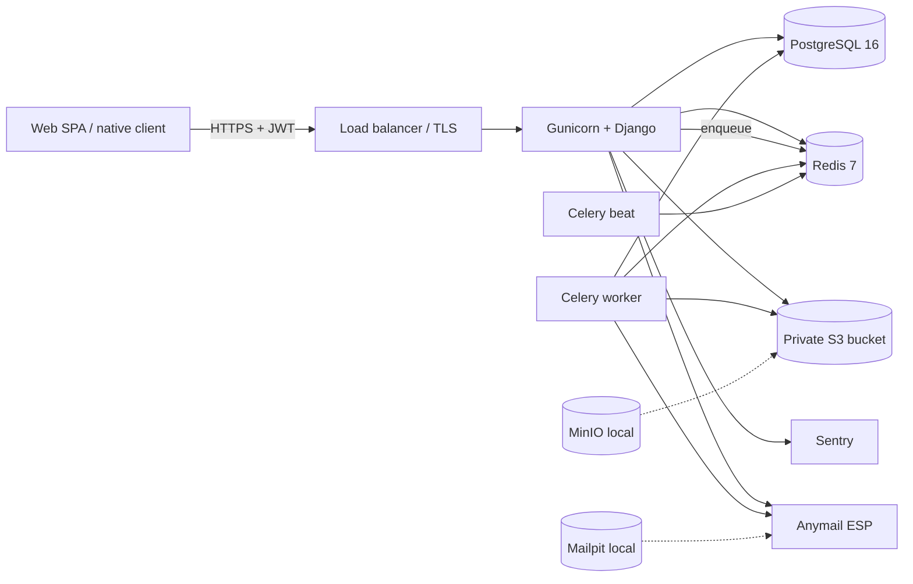
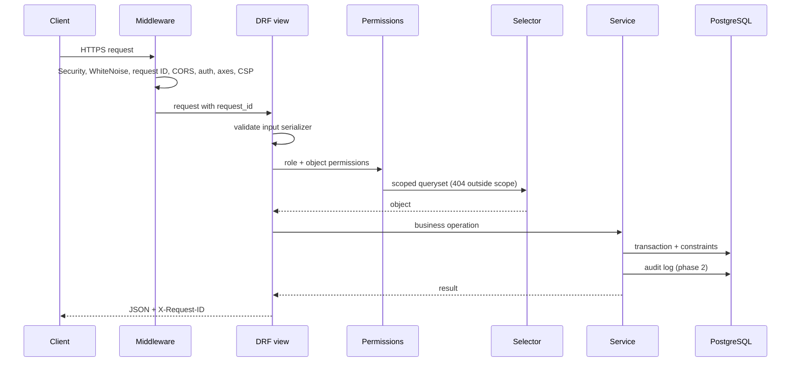
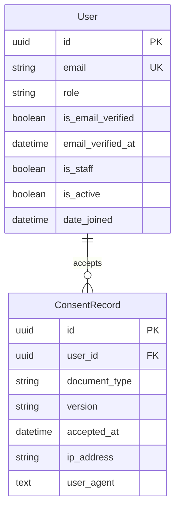

# Architecture

## 1. Context

Adelgaceya is a physician-supervised telehealth product in Peru. Patients
complete a medical assessment, upload labs, are reviewed by a physician, and
receive a prescription and programme. Physicians review clinical data and run
video consultations. Staff operate orders, subscriptions, content and support.
The backend is an API consumed by a web SPA and (potentially) native clients.

The data is sensitive personal health data under Peru's **Ley N.° 29733**. The
architecture therefore optimises for least privilege, explicit consent, audit
trails, and the ability to delete/anonymise data without breaking legal
retention obligations.

## 2. Principles

1. **Modular monolith.** One deployable, one database, clear app boundaries.
   Microservices would add distributed transactions and an audit surface that a
   small clinical team cannot operate safely.
2. **Thin views, explicit services, scoped selectors.** Views validate and
   delegate. Writes and state machines live in `services.py`; read scoping lives
   in `selectors.py`. Serializers never contain business rules.
3. **Deny by default.** DRF requires authentication globally. Role and
   object-level checks are explicit. Objects outside a caller's scope return
   **404**, not 403, so clinical records cannot be enumerated.
4. **Never trust the client.** Role, ownership, price, BMI, eligibility and
   status transitions are computed or checked server-side.
5. **Everything clinical is auditable.** Phase 2 adds a single audit service and
   DRF mixin used by every clinical read and write; ad-hoc log statements are
   not accepted as audit evidence.
6. **No PHI/PII in logs or task arguments.** Tasks receive UUIDs, not payloads.
   A structlog processor and a Sentry `before_send` hook redact identifiers.
7. **Boring, replaceable integrations.** Payment, video, storage, email and
   antivirus sit behind ports with fake adapters for tests and local dev.

## 3. Module map

| App | Responsibility | Phase |
| --- | --- | --- |
| `core` | Base model, request IDs, error envelope, pagination, permissions, encryption field, private storage, audit log, email port, health, logging, schema helpers | 1–2 |
| `accounts` | Custom user, roles, legal documents, consents, registration, JWT, Google, verification, password reset, lockout envelope | 1 |
| `assessments` | Programs and questionnaire versions/steps/questions, resumable assessments, measurements/BMI, answers, screening, evaluation state and history, fee/payment records, lab uploads, prescriptions | 2 |
| `catalog` | Public site settings, FAQs, testimonials, stats, complaint categories | 1 |
| `support` | Contact messages and complaints book | 1 |
| `patients` | Patient profile and preferences, addresses, ubigeo, care team, dashboard overview | 3 |
| `consultations` | Clinician profiles (physician/nurse), availability, consultation types, booking state machine, video port, reminders | 3 |
| `treatments` | Products, treatments, schedule-derived next dose, prescription download, renewal requests | 3 |
| `orders` | Packages, quote/checkout, order state machine, refunds, subscriptions and renewals | 3 |
| `payments` | Saved cards, charges/refunds through the provider port, signed Culqi and Daily webhooks (the `Payment` table stays in `assessments`) | 3 |
| `messaging` | Patient/care-team threads, encrypted messages, read receipts, ETag polling | 3 |
| `notifications` | In-app notifications and preference-aware generic emails | 3 |
| `reports` | Aggregate, cached analytics | 6 (planned) |

Part 2 deliberately keeps programs, assessments, evaluations, fees/payments,
labs and prescriptions in one `assessments` app. They share one aggregate
(assessment → evaluation) and one transaction boundary; splitting them now
would add cross-app transactions without an operational benefit. Profiles and
the physician workflow remain separate phases.

Each app has `models.py`, `serializers.py`, `views.py`, `urls.py`, `services.py`,
`selectors.py`, `permissions.py`, `filters.py`, `tasks.py`, `admin.py`, and
`tests/`.

## 4. Runtime topology



WhiteNoise serves hashed static assets directly from the web process. User
uploads never pass through WhiteNoise: they are private objects served with
short-lived pre-signed URLs.

## 5. Request lifecycle



Failures return the envelope
`{"code", "message", "details", "request_id"}`. Unknown `/api/` paths and 500s
also use it. No exception message or traceback is returned to clients.

## 5.1 Assessment and evaluation domain (Part 2)

- A `Program` owns admin-editable rules (target lower, `min_bmi`, age range,
  cooldown), fee configuration, projection copy and lab panels. A program is
  startable only when it has a published `QuestionnaireVersion`.
- An `Assessment` pins the published questionnaire at creation and stores
  canonical measurements plus the display units. Drafts are one per
  patient/program (partial unique constraint) and are resumable.
- Questionnaire steps are typed (`MEASUREMENTS`, `QUESTIONS`). Questions are
  single/multi choice, yes/no or text; conditional visibility uses
  `show_if`/`show_if_equals`. Screening effects live on questions/options and
  are admin-only.
- Submit computes screening, locks the assessment and creates one `Evaluation`
  plus a fee snapshot and the first `EvaluationStatusHistory` row. The fee is
  configuration, not a hardcoded price.
- Evaluation transitions are centralised in `EvaluationService`:

  ```text
  SCREENED_OUT  -> AWAITING_PAYMENT | SUBMITTED
  AWAITING_PAYMENT -> SUBMITTED | CANCELLED
  SUBMITTED -> IN_REVIEW | CANCELLED
  IN_REVIEW -> APPROVED | NOT_SUITABLE | PENDING_LABS | SUBMITTED
  PENDING_LABS -> SUBMITTED | CANCELLED
  APPROVED | NOT_SUITABLE | CANCELLED -> terminal
  ```

  Part 2 exposes only the patient transitions (payment success through the
  Part 3 webhook, review request, cancel, lab submit/skip). Physician decisions
  belong to Part 3.
- Payments go through a `PaymentProvider` port. A synchronous success is stored
  as `PENDING`; the verified webhook is the only path that finalises the fee.
- Lab files are private. The client asks for a pre-signed `PUT`, uploads
  directly, then confirms. Confirm verifies existence/size/magic bytes and
  queues a scan; only `CLEAN` files can be downloaded. Downloads and
  non-owner clinical reads write an `AuditLog` row.

## 5.2 Patient portal domain (Part 3)

- **One call per dashboard.** `GET /patients/me/overview/` computes sidebar
  visibility, the primary action (first-match rules), next consultation, next
  dose and counters on the server.
- **Slots are computed live** from weekly rules minus blocks, open
  consultations and the lead time. Booking locks the physician's profile row,
  recomputes, and relies on a partial unique constraint as the backstop.
- **Payments are webhook-final.** Checkout creates `Order(PENDING_PAYMENT)` and
  a `Payment(PENDING)`. Only the signed webhook moves money state; it is stored
  in `WebhookEvent` first, deduplicated by provider event id, applied in one
  transaction, and never moves a successful payment backwards. Provider payload
  parsing lives only in `apps/payments/culqi.py` and `apps/payments/daily.py`.
- **Refills are consumed** when the order reaches `PRESCRIPTION_VERIFIED` and
  restored on cancellation, under a row lock on the treatment.
- **Scheduled jobs** (Celery beat): `run_consultation_jobs` every 5 minutes
  (expiry, no-show, reminders) and `run_subscription_jobs` every 15 minutes
  (renewals, retries, period-end cancellation, auto-resume).
- **Notifications** are generic by construction (fixed bilingual copy per
  type); the in-app row is always written and the email follows preferences.
- **Datetimes**: DRF renders and parses in UTC (`apps.core.apps`); business
  dates (age, delivery estimates) use `America/Lima`.

## 5.3 Clinician domain (Part 4)

- **`apps.clinical`** holds onboarding, the review queue and decisions, My
  Patients, notes, clinician consultations, availability editing, the calendar
  and the dashboard. It reuses Part 2/3 models and state machines rather than
  duplicating them.
- **Gates:** `IsVerifiedPhysician` raises `credentials_not_verified`; MFA
  enrolment is enforced in `ContractJWTAuthentication`.
- **Decisions** are serialised per evaluation with a row lock, guarded by
  `If-Match` on `Evaluation.version` (bumped on every transition) and stored
  under `Idempotency-Key`. Approval writes the prescription, treatments and
  version 1 in one transaction, then queues the unsigned PDF.
- **Availability** is computed from AVAILABLE rules (per type), EXTRA blocks,
  BLOCKED rules/blocks and open consultations. Edits run inside a savepoint
  and roll back if a booked visit would lose coverage.
- **Beat job** `run_clinical_jobs` (15 min): release idle claims and apply due
  treatment versions.

## 5.4 Staff and admin portals (Part 5)

- **`apps.staff`** holds staff invitations, profiles and permissions, the
  staff dashboard and the staff views over patients, evaluations, tickets,
  complaints, orders, subscriptions and refunds. `apps/staff/api.py` provides
  the shared view helpers (`doc`, `params`, `page`, `validated`,
  `idempotent`) and `PortalSchema`, which derives operation ids from the view
  class name.
- **`apps.backoffice`** holds the admin catalog editors, the questionnaire
  editor, content and assets, reference data, legal versions, settings
  groups, reports and CSV exports, the audit log and privacy requests.
- **Runtime settings** live in `PlatformSettings` groups and are read through
  `apps.catalog.runtime`, falling back to environment defaults.
- **Beat job** `run_support_jobs` (hourly): auto-close resolved tickets.
  Report exports run as a Celery task after commit.

## 6. Identity and authentication

- Custom `accounts.User` with UUID PK, lowercase-unique email, `role`
  (`PATIENT`, `PHYSICIAN`, `STAFF`, `ADMIN`), `is_email_verified` and
  `email_verified_at`. It is created in the first migration; `AUTH_USER_MODEL`
  points at it before anything else.
- Access JWT: 15 minutes. Refresh JWT: 7 days, rotating, blacklisted after
  rotation. Logout blacklists the presented refresh token; password reset
  blacklists all outstanding refresh tokens. Access tokens cannot be revoked
  before expiry; see ADR-0002 for the trade-off.
- Registration follows the owner-approved Part 1 contract: `201` on success,
  a generic `400 validation_error` for an existing address, and an
  account-exists email with a reset link. Terms and privacy consent are stored
  with version, timestamp, IP and user agent. The enumeration trade-off is
  recorded in `docs/contract-deviations.md`.
- Email verification uses a stateless signed token bound to the user's email,
  password and verification state; the link expires after
  `EMAIL_VERIFICATION_TIMEOUT` (24 hours by default) and is single-use.
- Password reset always returns 204. Reset tokens are single-use by construction
  (the password hash participates in the token) and revoke outstanding refresh
  tokens.
- Google sign-in verifies a Google ID token through django-allauth. A verified
  Google email may link to an existing account; an unverified Google email is
  rejected. New Google users become `PATIENT` and have an unusable password.
- django-axes locks out credential stuffing per username+IP after five failures
  for 15 minutes. DRF scoped throttles add independent limits for auth,
  password reset, email verification, uploads and messaging.

## 7. Data conventions

- **Identifiers:** UUIDv4 primary keys everywhere (ADR-0004). Sequential
  identifiers are exposed only where the law requires them (complaints book).
- **Measurements:** kg and cm are canonical. lb and ft/in are display-only
  conversions. BMI and eligibility are always server-side.
- **Money:** integer minor units or `DecimalField` plus ISO currency. Floats are
  forbidden. Pricing is recalculated server-side before charging.
- **Time:** UTC in the database (`USE_TZ=True`), `America/Lima` as the business
  timezone, ISO-8601 with offset in APIs.
- **Soft delete:** only where legal retention or an audit trail requires it.
  Privacy deletion uses an explicit anonymisation workflow, not a boolean.
- **Encryption:** clinical free text and sensitive identifiers use
  `EncryptedTextField` (Fernet via `MultiFernet`) in addition to database and
  bucket encryption at rest (ADR-0003).
- **Constraints:** unique constraints, check constraints and explicit indexes
  for every filter/order field used by a list endpoint.

### Phase 1 ERD



The full target ERD is in [erd.md](erd.md) and will be completed as phases land.

## 8. API surface by screen

| Screen | Implemented endpoints | Later endpoints |
| --- | --- | --- |
| Auth | register, login, refresh, logout, verify email, resend, password reset, change password, Google, me | — |
| Legal/consent | current legal documents, consent history/create | — |
| Public | site settings, FAQs, testimonials, stats, complaint categories, contact, complaints book | — |
| Assessment | programs, create/resume/list/detail, questionnaire, measurements, step upsert, summary, submit, request-review, cancel | patient profile and unit preferences (Part 3) |
| Labs | lab recommendations, pre-signed upload create, list/detail/delete, confirm, pre-signed download, submit, skip | physician review of lab results (Part 3) |
| Evaluation | patient evaluation status/checklist/journey, fee snapshot, pay attempt, prescription download | physician queue, decide, request labs, history (Part 3); verified payment webhook (Part 3) |
| Portal | — | overview, consultations, treatment, orders, messages |
| Admin | user/consent admin, program/questionnaire/screening/fee/lab configuration | patient/physician/staff CRUD, reports |
| Reports | — | revenue, MRR, orders, users, evaluation outcomes, churn |

All resource routes are plural nouns under `/api/v1/`. Non-CRUD actions use
`@action` (`POST /evaluations/{id}/approve/`). Lists are paginated (page-number
for admin, cursor for messages) and support filtering/search/ordering where
useful.

## 9. Async work and integrations

- Celery tasks are idempotent, retry with exponential backoff and jitter, have
  hard/soft time limits, and are enqueued with `transaction.on_commit`.
- Email tasks take a **user id only**. The worker loads the user and renders the
  template; a sanitised transport exception prevents recipient addresses from
  entering Celery tracebacks.
- Payment (`Culqi` default + Fake), video (`Daily.co` default + Fake), storage,
  email and antivirus are ports. Provider SDKs are imported only inside their
  adapter (ADR-0005/0006).
- Part 2 lab confirmation enqueues `scan_lab_upload` with
  `transaction.on_commit`; the default `NoopLabScanner` is local/test-only and
  production must configure a ClamAV adapter. Scan retries are idempotent.
- Part 2 payments are written synchronously through the provider port, but a
  synchronous success stays `PENDING` until the Part 3 signature-verified
  webhook calls `PaymentService.mark_succeeded`.
- Outbox/event delivery for money-moving events is designed in Phase 4;
  raw webhook payloads are stored once, with a unique provider event id.

## 10. Deployment

- Multi-stage Python 3.12 slim image, non-root user, no build tools in the final
  layer, `collectstatic` at build, Docker healthcheck.
- `docker compose` runs web, worker, beat, PostgreSQL 16, Redis 7, MinIO and
  Mailpit. The web container runs migrations once at start; workers do not.
- Production uses `config.settings.production`, which fails fast if secrets,
  hosts, database, broker, bucket, encryption keys or CSRF origins are missing.
- Gunicorn uses `gthread`, bounded workers, `max_requests` with jitter, a 60s
  timeout and query-string-free access logs.
- `CONN_MAX_AGE=60` and health checks are enabled; with PgBouncer use
  transaction pooling and `CONN_MAX_AGE=0` (see runbook).

## 11. Assumptions

- The SPA is a separate origin and uses bearer JWTs (ADR-0002).
- Culqi is the initial payment provider for PEN/USD; Stripe remains an adapter
  option if the commercial contract changes.
- Daily.co is the video provider; rooms/tokens are scoped to one consultation.
- S3-compatible storage is available in every environment; MinIO mirrors it
  locally.
- ClamAV is available as a sidecar/service in staging and production.
- E-mail is delivered by an ESP through Anymail, not SMTP in production.
- The clinical eligibility rules and consent texts require review by a licensed
  Peruvian physician and legal counsel; they are configurable and marked
  `LEGAL_REVIEW` rather than invented.

Open questions and unresolved external decisions are tracked in
[open-items.md](open-items.md).
