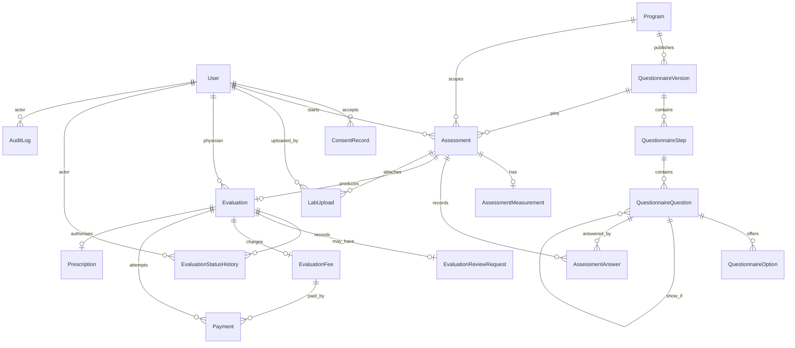

# Entity relationship diagram

Parts 1 (v1.2) and 2 (v1.0) are implemented. The diagram below shows the tables
that exist today. Planned Part 3–6 entities (profiles, consultations, orders,
messaging, reports) remain in the target model and are listed after it so
naming and ownership can be reviewed before code is written.



## Implemented entities

| Entity | Purpose / key rules |
| --- | --- |
| `User` | Single identity for all roles: `PATIENT`, `PHYSICIAN`, `STAFF`, `ADMIN`. |
| `ConsentRecord` | Accepted legal document version with timestamp, IP and user agent. |
| `Program` | Admin-editable clinical rules, fee, projection copy, lab panels and lab group label. |
| `QuestionnaireVersion` | Pinned, published questionnaire per program; one published version at a time. |
| `QuestionnaireStep` | `MEASUREMENTS` or `QUESTIONS`, ordered by `position`. |
| `QuestionnaireQuestion` | Type, required flag, `show_if`/`show_if_equals`, and admin-only screening effects. |
| `QuestionnaireOption` | Ordered option with `is_exclusive` and an admin-only screening effect. |
| `Assessment` | One draft per patient/program; pinned questionnaire; status, screening result, labs status and display units. |
| `AssessmentMeasurement` | Canonical kg/cm, sex, DOB, server-computed BMI/target BMI/category/goal. |
| `AssessmentAnswer` | One row per answered question; option ids, yes/no value or encrypted text. |
| `Evaluation` | One per submitted assessment; status, physician, timestamps, lab-recommendation snapshot. |
| `EvaluationStatusHistory` | Append-only transition log with actor and encrypted reason. |
| `EvaluationReviewRequest` | One per evaluation; patient note for a `SCREENED_OUT` review request. |
| `EvaluationFee` | Fee snapshot at submit: status, amount, currency, inclusions, payment methods. |
| `Payment` | Append-only payment attempts; provider id, failure code and optional 3DS action. |
| `LabUpload` | Private object key, metadata, scan status/rejection reason and soft delete. |
| `Prescription` | Minimal approved prescription summary plus the storage key for the PDF. |
| `AuditLog` | Append-only clinical/security audit: actor, action, object, request id, IP, user agent, redacted metadata. |
| `IdempotencyRecord` | Stored response for the 24-hour `Idempotency-Key` replay window. |

## Relationships and constraints

- `Assessment` has a partial unique constraint on `(user, program)` where
  `status = DRAFT`, and indexes on `(user, status)` and `(program, status)`.
- `QuestionnaireStep.key` is unique per questionnaire; `QuestionnaireQuestion.key`
  is unique per step; `AssessmentAnswer` is unique per assessment and question.
- `Evaluation` is one-to-one with `Assessment`; `EvaluationFee`,
  `EvaluationReviewRequest` and `Prescription` are one-to-one with `Evaluation`.
- `Payment` and `EvaluationStatusHistory` are append-only child tables.
- `LabUpload.storage_key` is unique; `(assessment, is_deleted)` and `status` are
  indexed. Deleted files are soft-deleted and their object is removed.
- `AuditLog` has no update/delete API; `object_type` and `object_id` identify the
  target without a hard foreign key, so the trail survives domain changes.

## Evaluation state machine

```text
SCREENED_OUT   -> AWAITING_PAYMENT | SUBMITTED
AWAITING_PAYMENT -> SUBMITTED | CANCELLED
SUBMITTED      -> IN_REVIEW | CANCELLED
IN_REVIEW      -> APPROVED | NOT_SUITABLE | PENDING_LABS | SUBMITTED
PENDING_LABS   -> SUBMITTED | CANCELLED
APPROVED | NOT_SUITABLE | CANCELLED -> terminal
```

Part 2 exposes the patient transitions only. Physician decisions and the
verified payment webhook that performs `AWAITING_PAYMENT → SUBMITTED` are
Part 3.

## Part 3 entities

| Entity | App | Purpose / key rules |
| --- | --- | --- |
| `PatientProfile` | patients | One per patient: phone, default address, units, language, timezone, email preferences, marketing opt-in time, assigned nurse. |
| `Address` | patients | Up to 10 per patient; one default (partial unique); `ubigeo` must be a district. |
| `Ubigeo` | patients | INEI code (2/4/6 digits) with parent chain and district `is_deliverable`. |
| `ClinicianProfile` | consultations | Physician or nurse public data, CMP label, timezone, accepts-new flag. |
| `AvailabilityRule` / `AvailabilityBlock` | consultations | Weekly windows and blocked intervals used for live slots. |
| `ConsultationType` | consultations | Seeded `INITIAL`, `METABOLIC_RESET`, `FOLLOW_UP`; duration sets slot length. |
| `Consultation` / `ConsultationStatusHistory` | consultations | Booking and state history. Partial unique `(physician, start)` for open statuses holds the slot. |
| `Product` | treatments | Catalog item with description, image and `[MEDICAL REVIEW]` safety text. |
| `Treatment` / `TreatmentRenewalRequest` | treatments | Prescription schedule, dose, refills; one pending renewal per treatment. |
| `Package` / `PackageItem` | orders | Purchasable bundle; price is the sum of item prices. |
| `Order` / `OrderItem` / `OrderStatusHistory` / `OrderSequence` | orders | Checkout snapshot (address, prices), immutable history, `ADL-ORD-` numbering. |
| `Subscription` | orders | Recurring package with period, billing, pause/cancel and retry state. |
| `SavedPaymentMethod` | payments | Provider card reference only (brand, last4, expiry); soft delete. |
| `WebhookEvent` | payments | Raw provider event; unique `(provider, provider_event_id)`. |
| `MessageThread` / `Message` | messaging | One thread per patient/participant pair; encrypted bodies; read receipts. |
| `Notification` | notifications | Generic in-app notice with optional navigation target. |

`Payment` (assessments) now carries `purpose`, `user`, `refunded_amount` and
nullable links to `evaluation`/`fee` (fees), `order` and `subscription`.

## Consultation and order state machines

```text
Consultation: REQUESTED -> CONFIRMED | DECLINED | EXPIRED | CANCELLED | REQUESTED (reschedule)
              CONFIRMED -> IN_PROGRESS | CANCELLED | NO_SHOW | REQUESTED (reschedule)
              IN_PROGRESS -> COMPLETED
Order:        PENDING_PAYMENT -> PRESCRIPTION_VERIFIED | PAYMENT_FAILED | CANCELLED
              PAYMENT_FAILED -> PENDING_PAYMENT | CANCELLED
              PRESCRIPTION_VERIFIED <-> ON_HOLD; PRESCRIPTION_VERIFIED -> COMPOUNDING
              COMPOUNDING -> IN_TRANSIT -> OUT_FOR_DELIVERY -> DELIVERED
              PRESCRIPTION_VERIFIED..DELIVERED -> REFUNDED; ON_HOLD -> CANCELLED
```

## Part 4 entities

| Entity | App | Purpose / key rules |
| --- | --- | --- |
| `Specialty` | clinical | Admin list; `requires_registration_number` drives the RNE field. |
| `PhysicianInvitation` | clinical | Single-use, SHA-256 token hash, 7-day expiry, status. |
| `AvatarUpload` | clinical | Pre-signed upload, re-encoded image, tied to a user or invitation. |
| `PrescriptionDocument` | clinical | Optional signed PDF, scanned like lab files. |
| `ClinicalNote` | clinical | Append-only, encrypted body, optional consultation link. |
| `TreatmentVersion` | treatments | Immutable dose/schedule history; future versions applied by a job. |
| `MfaDevice` / `MfaBackupCode` / `MfaChallenge` | accounts | Encrypted TOTP secret, hashed backup codes, hashed 5-minute login token. |

Extended: `ClinicianProfile` (verification, license, specialty, phone,
languages, avatar), `Evaluation` (`version`, claim timestamps, internal note,
rejection code), `QuestionnaireQuestion.review_group`, `Prescription` (issuer,
dates, signed document), `Product` (guardrails, programs), `Treatment`
(instructions, duration, prescription), `TreatmentRenewalRequest` (decision),
`Consultation` (agenda, physician join, notes, follow-up, cancelled by),
`AvailabilityRule` (kind, label, types), `AvailabilityBlock` (kind),
`Subscription` (`needs_staff_review`).

## Planned entities (not yet migrated)

- Physician decision records, prescription PDFs and availability management
  endpoints (Part 4).
- Staff order/shipping/refund tooling, `SupportTicket` (Part 5) and analytics
  projections (Part 6).
- `MessageAttachment`, device tokens for push (`[OPEN]`).

The Phase 1 identity/consent ERD is also in
[architecture.md](architecture.md#phase-1-erd).
