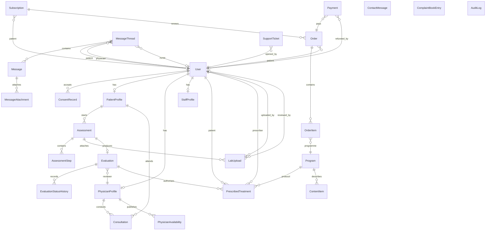

# Entity relationship diagram

Phase 1 is implemented. Phase 2–6 entities are the approved target and will be
added as migrations land; they are shown here so naming and ownership can be
reviewed before code is written.

## Notes

- `User` is the single identity for all roles; profiles are one-to-one.
- `Assessment` is versioned and resumable. Steps have typed payloads validated
  per step. Measurements are stored in kg/cm only.
- `Evaluation` is the state machine:
  `SUBMITTED → IN_REVIEW → APPROVED | NOT_SUITABLE | PENDING_LABS`.
  Every transition appends `EvaluationStatusHistory`; the history table has no
  update/delete API.
- `LabUpload` files are private. A file is physician-visible only when its scan
  status is `CLEAN`; downloads are short-lived pre-signed URLs.
- `ComplaintBookEntry` has an immutable, gap-free sequential number required by
  Peruvian consumer-protection rules. Legal wording is marked `LEGAL_REVIEW`.
- `AuditLog` is append-only and records actor, action, object, request id, IP,
  user agent and a before/after diff with PHI redaction at the application edge.

The Phase 1 ERD (users and consents only) is also in
[architecture.md](architecture.md#phase-1-erd).
